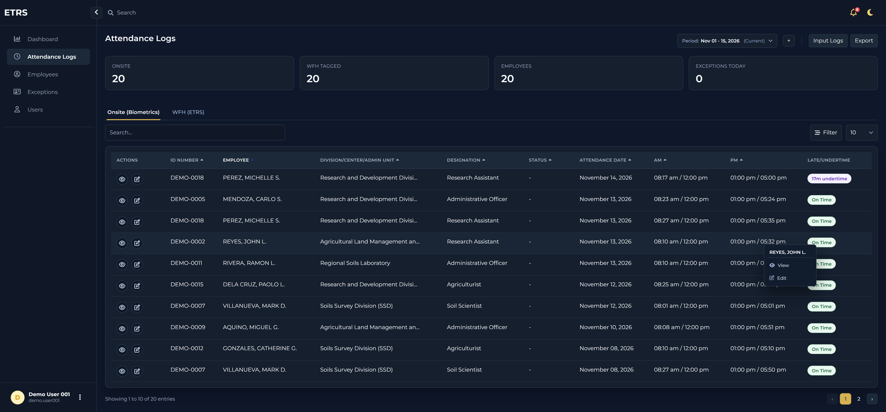

<p align="center">
  
</p>

<h1 align="center">Electronic Time Recording System</h1>

<p align="center">
  A web-based attendance and time-recording system for managing employee attendance, work-from-home records, and administrative workflows.
</p>

<p align="center">
  
  
  
</p>

## Overview

ETRS (Electronic Time Recording System) is an ASP.NET Core application built with Blazor Interactive Server. It brings employee time records and attendance administration into one interface, with role-based access and tools for reviewing, filtering, and exporting attendance information.

### What it includes

- **Attendance dashboard** with summaries and visual reporting.
- **Attendance logs** for reviewing and exporting time records, including PDF output.
- **Work-from-home attendance** with photo-based verification and supporting MOV uploads.
- **Employee directory** for maintaining employee records.
- **Exception conditions** for configuring attendance-related exceptions.
- **User administration** with roles, access levels, account activation, and password management.
- **Authentication** with JWT-backed API endpoints and application sign-in.
- **Email workflows** for attendance requests and verification, configurable through SMTP.
- **Swagger UI** for exploring the API.

## Technology

- .NET 10 / ASP.NET Core
- Blazor Interactive Server and SignalR
- Entity Framework Core 10
- Microsoft SQL Server
- JWT bearer authentication
- Swagger / OpenAPI
- QuestPDF for PDF exports
- MediaPipe for browser-based face detection support

## Getting started

### Prerequisites

- .NET 10 SDK
- SQL Server (LocalDB, SQL Server Express, or another SQL Server instance)
- Git

### 1. Clone the repository

```bash
git clone <repository-url>
cd etrs
```

### 2. Configure the database

Update `ConnectionStrings:DefaultConnection` in `appsettings.Development.json` or supply it through user secrets/environment variables. For example, a local SQL Server Express connection:

```json
{
  "ConnectionStrings": {
    "DefaultConnection": "Server=localhost\\SQLEXPRESS;Database=etrs;Trusted_Connection=True;TrustServerCertificate=True;"
  }
}
```

Create the `etrs` database or ensure the configured SQL Server account can create/update it. On startup, the app applies the EF Core migrations and runs schema compatibility updates. In Development, it also seeds sample users, employees, attendance logs, work-from-home records, exception conditions, and email requests.

### 3. Set a JWT signing key

The application validates JWT issuer, audience, signing key, and token lifetime. Configure a strong, private signing key and matching issuer/audience values. Keep secrets out of committed configuration. For local development, use .NET user secrets:

```bash
dotnet user-secrets set "Jwt:Key" "<a-long-random-secret>"
dotnet user-secrets set "Jwt:Issuer" "ETRS"
dotnet user-secrets set "Jwt:Audience" "ETRS"
```

### 4. Run the application

```bash
dotnet restore
dotnet run
```

Open the HTTPS URL printed in the console (the default development profile is `https://localhost:7271`). The main app is available at `/etr`; the sign-in page is at `/etr/login`. Swagger UI is available at `/swagger`.

## Development accounts and sample data

In the Development environment, the application seeds demo accounts and sample records. The built-in demo sign-in is:

| Username | Password |
| --- | --- |
| `demo.user001` | `Demo@123` |

The login page’s demo shortcut is enabled by default in `appsettings.Development.json`. The startup seeder also creates a local bootstrap administrator (`admin` / `Admin@123`) when one does not already exist. These are development-only credentials. The demo account is an administrator and demo accounts are seeded only in Development; do not turn on the shortcut against a production database.

### Render deployment

Render runs this app in Production, so it does not load `appsettings.Development.json`. To display the demo shortcut, add `DemoLogin__Enabled=true` under **Environment** for the Render web service and redeploy. This only controls whether the button is rendered; it does not create a demo account. The current demo account seeder is Development-only and grants administrator access. Only enable the shortcut when the app is connected to a separate demo database with a suitably restricted demo account. Aiven is the database provider; configure this setting on Render, not Aiven.

## Configuration

Use `appsettings.Development.json`, .NET user secrets, or environment variables for local settings. For deployment, inject secrets from the hosting environment and do not commit credentials.

| Setting | Purpose |
| --- | --- |
| `ConnectionStrings:DefaultConnection` | SQL Server database connection. |
| `Jwt:Issuer`, `Jwt:Audience`, `Jwt:Key` | JWT validation settings; use a strong secret key. |
| `DemoLogin:Enabled` | Shows the demo login shortcut when enabled. In Render, set `DemoLogin__Enabled=true` on the web service. Enable it only with a separate demo database and restricted demo account. |
| `Email:Smtp:Host`, `Email:Smtp:Port` | SMTP server used for email workflows. |
| `Email:Smtp:Accounts` | SMTP sender account credentials; configure with user secrets/environment variables. |
| `Uploads:WfhMovPath` | Optional shared folder for work-from-home MOV files. Ensure the app identity has read/write access. |

For SMTP, configure the sender account(s) in `Email:Smtp:Accounts` with the account properties expected by `EtrsMailerOptions` in `Services/AttendanceEmailService.cs`. For example, add secrets without editing tracked JSON:

```bash
dotnet user-secrets set "Email:Smtp:Accounts:0:Email" "sender@example.com"
dotnet user-secrets set "Email:Smtp:Accounts:0:Password" "<smtp-app-password>"
```

## Useful routes

| Route | Page |
| --- | --- |
| `/etr` | Home / redirect entry point |
| `/etr/login` | Sign in |
| `/etr/dashboard` | Attendance dashboard |
| `/etr/attendance-logs` | Attendance logs |
| `/etr/etr-work-from-home` | Work-from-home time recording |
| `/etr/employees` | Employee management |
| `/etr/exceptions` | Exception conditions |
| `/etr/users` | User administration |
| `/swagger` | API documentation |

## Project structure

```text
Components/       Blazor pages, layouts, and shared UI
Controllers/      HTTP API controllers
Data/             EF Core context, migrations, and seeders
DTO/              Authentication and API data transfer objects
Model/            Domain entities
Repositories/     Data access implementations and interfaces
Services/         Authentication, access policy, email, and export services
State/            Authentication and session state helpers
wwwroot/          Styles, scripts, images, and browser assets
```

## Notes

- Database migrations run automatically during application startup.
- Seed data runs only in the Development environment, except the bootstrap administrator seeder, which runs in all environments if the `admin` account is absent.
- The optional work-from-home upload location may point to a network share; configure it for the deployment environment and grant the application appropriate permissions.
- The application uses HTTPS redirection. Configure valid HTTPS endpoints/certificates for deployment.
